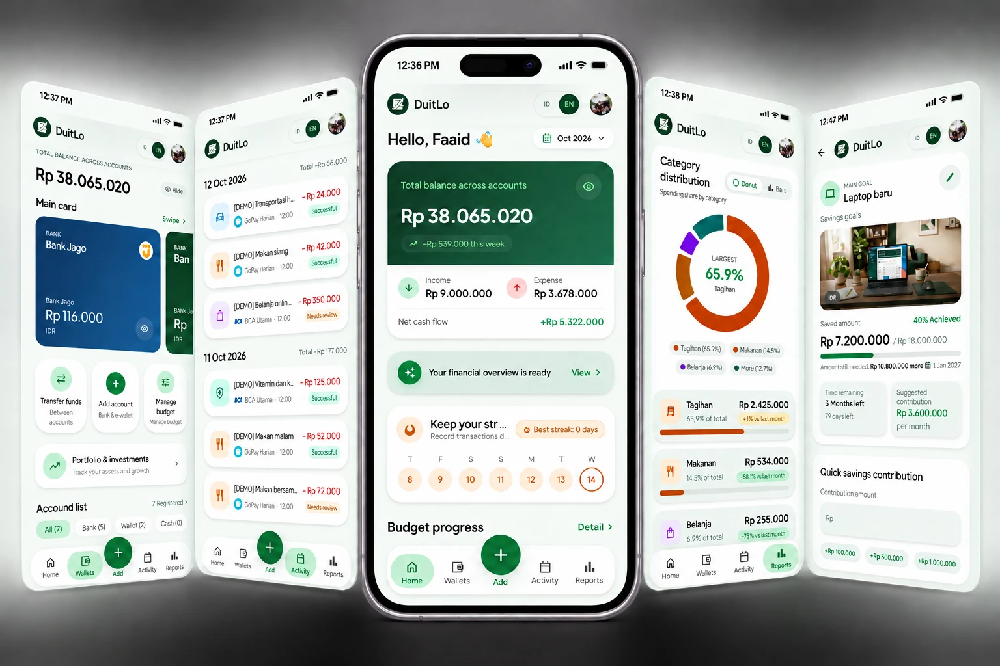
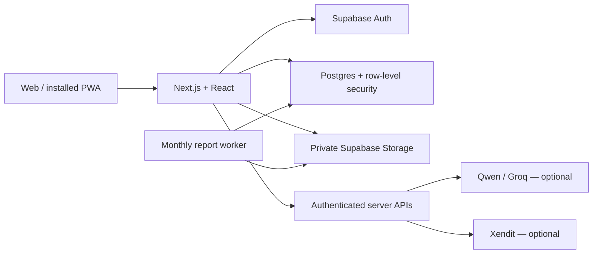

<p align="center">
  
</p>

<h1 align="center">DuitLo</h1>

<p align="center">
  <strong>Duit lo, rencana lo.</strong><br />
  <em>Your money, your plans.</em><br />
  Track everyday spending, understand your cash flow, and make room for your next goal.
</p>

<p align="center">
  <a href="https://duitlo.vercel.app"><strong>Live App</strong></a> ·
  <a href="#product-preview"><strong>Product preview</strong></a> ·
  <a href="#quick-start"><strong>Quick start</strong></a> ·
  <a href="docs/architecture.md"><strong>Architecture</strong></a> ·
  <a href="docs/operations.md"><strong>Operations</strong></a> ·
  <a href="SECURITY.md"><strong>Security</strong></a>
</p>

<p align="center">
  <a href="https://github.com/kuchikamizake05/DuitLo/actions/workflows/ci.yml"></a>
  
  
  
  
  
</p>

---

## Product preview

<p align="center">
  
</p>

DuitLo is a personal finance web app for keeping wallets, transactions, budgets, and savings goals together. It also includes investment and trading journals for a broader view of your finances.

The interface supports Indonesian and English, light and dark themes, and mobile and desktop layouts. Install it as a PWA for quick access from your home screen.

*Preview imagery comes from the landing page; it illustrates the product rather than a live account.*

## Why DuitLo

- **Know where your money goes.** Record income and expenses across bank, cash, and e-wallet accounts.
- **Give spending a plan.** Set monthly budgets and check progress toward savings goals.
- **Capture with less typing.** Extract receipt details, review them, then save the transaction.
- **Understand the numbers.** Review reports and calculated financial metrics, with optional AI explanations.
- **Keep ownership clear.** Authenticated records are scoped to their owner through Supabase row-level security.

## Core features

| Area | What you can do |
| --- | --- |
| Home and wallets | Review balances, cash flow, recent activity, and accounts across currencies. |
| Transactions | Record income and expenses, search activity, manage categories, and transfer between wallets. |
| Receipt capture | Extract receipt data with Qwen Vision and review the result before recording it. |
| Budgets and goals | Plan monthly category spending, set savings targets, and record goal deposits. |
| Reports and insights | Review spending patterns, access report archives, and request optional AI explanations of calculated metrics. |
| Investment journal | Record buys and sells, fees, cost basis, realized results, and portfolio snapshots. |
| Trading journal | Keep trade plans, risk, execution results, emotions, and lessons together. |
| Account and preferences | Manage language, appearance, data controls, and account access. |

AI features require provider configuration. Investment and trading writes, scan quotas, and planning limits depend on the enabled billing configuration; see [Free and Pro behavior](docs/billing-xendit.md).

## How it works

1. **Create your first wallet.** Choose an account type and enter its opening balance.
2. **Record your activity.** Add a transaction manually or review a scanned receipt.
3. **Plan what comes next.** Set a budget or savings goal and follow your progress through reports.

## Architecture and stack



| Layer | Technology |
| --- | --- |
| Application | Next.js 16 App Router, React 19, TypeScript |
| Interface | Tailwind CSS 4, Lucide React, Motion, Recharts |
| Forms and validation | React Hook Form, Zod |
| Identity and storage | Supabase Auth, PostgreSQL, Storage |
| Optional integrations | OpenRouter (Qwen), Groq, Xendit, n8n, Telegram |
| Report automation | Go worker and GitHub Actions |
| Verification | Vitest, Playwright, ESLint, TypeScript, database integrity checks |

See the [architecture guide](docs/architecture.md) for module boundaries and request flow. Optional automation templates live in [`n8n/`](n8n/).

## Quick start

Use **Node.js 22** to match CI and **pnpm 10.30.3**, pinned in `package.json`. The authenticated application needs a Supabase project.

```bash
git clone https://github.com/kuchikamizake05/DuitLo.git
cd DuitLo
corepack enable
pnpm install --frozen-lockfile
```

Copy [`.env.example`](.env.example) to `.env.local`:

```bash
# macOS / Linux
cp .env.example .env.local
```

```powershell
# Windows PowerShell
Copy-Item .env.example .env.local
```

Set `NEXT_PUBLIC_SUPABASE_URL` and `NEXT_PUBLIC_SUPABASE_ANON_KEY`, then follow the [reviewed database setup](docs/database-release.md) and [authentication configuration](docs/development-guide.md#authentication-setup).

```bash
pnpm dev
```

Open [localhost:3000](http://localhost:3000). Configure optional services only when needed. Keep provider keys and privileged credentials server-side, and never commit `.env.local`.

> [!IMPORTANT]
> For a fresh database, use the reviewed bootstrap manifest. For an existing database, reconcile its schema and migration history first. Do not replay the historical migration directory blindly. See [database release and recovery](docs/database-release.md).

Full setup, environment guidance, optional workflows, and deployment instructions are in the [development guide](docs/development-guide.md).

## Quality and project status

The repository includes automated checks for financial calculations, authentication and ownership boundaries, application flows, themes, and responsive layouts. Browser CI uses controlled fixtures; it does not establish that a production service is configured correctly.

```bash
pnpm check            # Lint, typecheck, unit tests, production build
pnpm audit:security   # Production dependency audit
pnpm test:e2e         # Desktop and mobile browser checks
```

Playwright builds an isolated application on port `3100`. See [CI documentation](docs/ci.md) for coverage and execution details, and [workflow runs](https://github.com/kuchikamizake05/DuitLo/actions) for current results.

| Scope | Status and boundary |
| --- | --- |
| Personal finance app | Wallets, transactions, budgets, goals, reports, and journals are implemented; availability depends on configuration and access. |
| AI assistance | Optional provider integrations; extracted receipts need review and AI explanations are advisory. |
| Pro payments | Xendit payment-session integration exists. Billing is disabled by default; live sales require merchant configuration and completion of the billing release checklist. |
| Production operations | Deployment, access checks, monitoring, backup recovery, and payment operations require environment-specific verification. |

DuitLo records and analyzes financial activity. It does not connect directly to bank balances, custody funds, or execute broker trades.

## Documentation

| Guide | Contents |
| --- | --- |
| [Development](docs/development-guide.md) | Local setup, authentication, environment variables, optional integrations, and deployment |
| [Architecture](docs/architecture.md) | Code organization and dependency boundaries |
| [Financial journey](docs/financial-journey.md) | Financial workflows and domain behavior |
| [Continuous integration](docs/ci.md) | Automated checks and browser coverage |
| [Database releases](docs/database-release.md) | Reviewed bootstrap, migration reconciliation, and recovery |
| [Operations](docs/operations.md) | Deployment and operational procedures |
| [Xendit billing](docs/billing-xendit.md) | Entitlements, checkout, webhooks, and launch gates |
| [Data controls](docs/data-control-operations.md) | Export, deletion, and account data operations |
| [Security policy](SECURITY.md) | Reporting a vulnerability privately |

## Repository map

```text
DuitLo/
├── src/
│   ├── app/                 Pages and API routes
│   ├── components/          Shared UI and application views
│   ├── config/              Configuration and security headers
│   ├── infrastructure/      Supabase clients
│   ├── lib/                 Domain rules and calculations
│   └── server/              Server-only services
├── public/                  Brand, landing, and PWA assets
├── supabase/                Reviewed bootstrap and migration history
├── e2e/                     Browser tests and controlled fixtures
├── worker/                  Monthly report worker
├── n8n/                     Optional workflow templates
├── scripts/                 Database checks and project utilities
├── docs/                    Development and operational documentation
└── .github/workflows/       CI and scheduled jobs
```

## Contributing

Create a focused branch from `main`, follow the [architecture boundaries](docs/architecture.md), and run the verification commands above. Include meaningful tests for changes to financial behavior or access controls, and explain any environment or database changes.

Keep credentials, receipts, database dumps, and personal financial records out of commits. Report vulnerabilities through the private channel described in [SECURITY.md](SECURITY.md).
